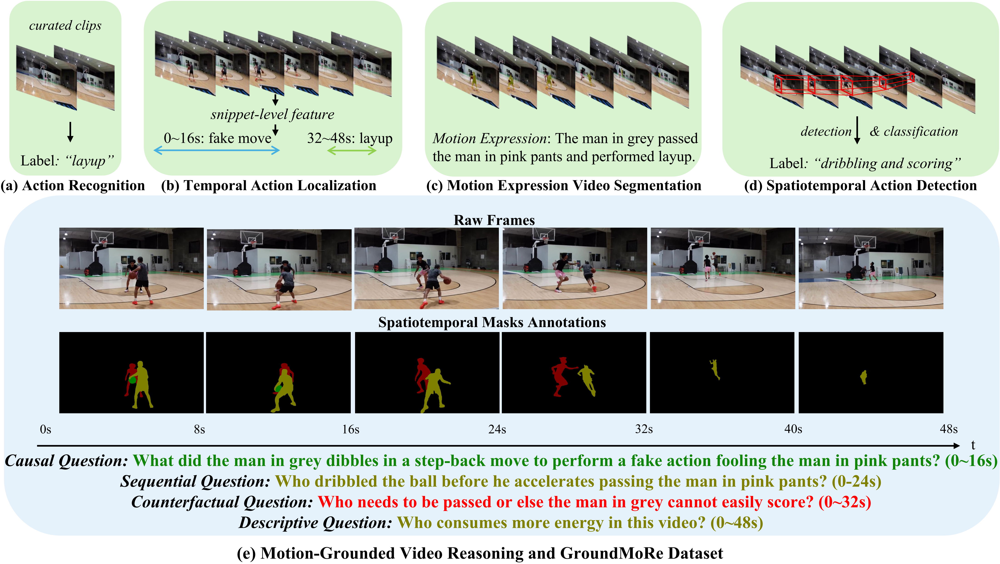
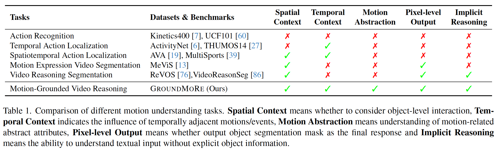
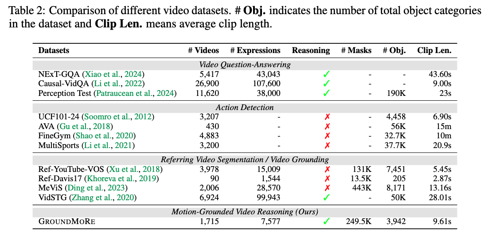
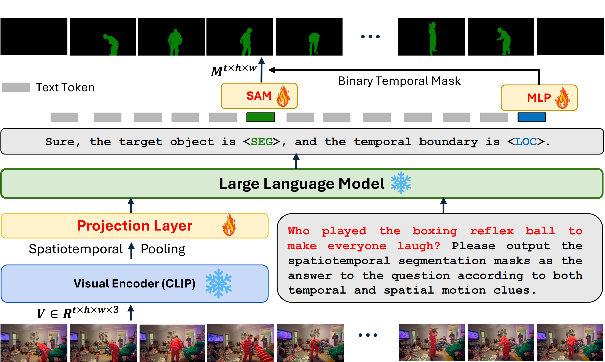
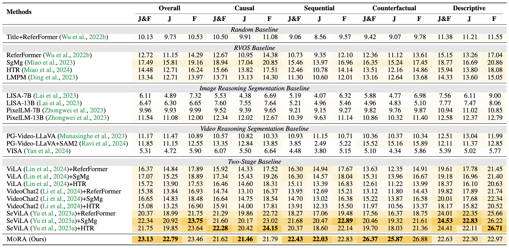
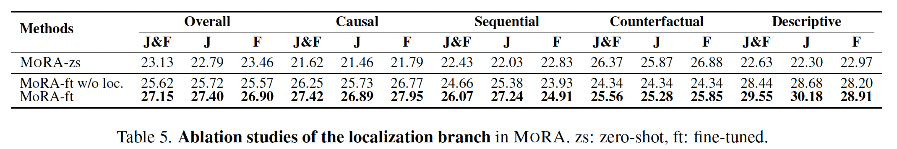

# Motion-Grounded Video Reasoning: Understanding and Perceiving Motion at Pixel Level

**[CVPR 2025]**  
[[Project Page](https://groundmore.github.io)] [[Paper](assets/GroundMoRe_CVPR2025_Camera_Ready.pdf)] [[Supp](assets/GroundMoRe_CVPR2025_Supp.pdf)] [[Dataset](https://huggingface.co/datasets/groundmore/GroundMoRe/tree/main)]

## Update

MoRA checkpoints are available on Hugging Face:

- **MoRA-LISA-7B GroundMoRe finetuned model**: [groundmore/mora-ft-lisa7b](https://huggingface.co/groundmore/mora-ft-lisa7b)
- **MoRA-Qwen3-VL-8B GroundMoRe finetuned checkpoint repository**: [groundmore/mora-ft-qwen3-vl-8b](https://huggingface.co/groundmore/mora-ft-qwen3-vl-8b)

Users can either train MoRA from scratch / finetune from intermediate checkpoints with the instructions below, or download released checkpoints from Hugging Face for evaluation.

<!--  -->

---

## 🧠 Overview

We introduces a new task: **Motion-Grounded Video Reasoning**, where models must answer motion-related questions using **spatiotemporal segmentation masks** as visual responses.

This task addresses key limitations in prior video understanding research by introducing:
- ❓ Implicit question-based reasoning  
- 🕒 Motion-aware temporal localization  
- 🧍 Object-level visual grounding  
- 🎯 Pixel-level mask generation across time  
- 🧩 Four question types: **Causal**, **Sequential**, **Counterfactual**, and **Descriptive**

---

## 📌 Comparison to Prior Tasks


> **Figure 1**: GROUNDMORE fills the gap between referring segmentation, temporal grounding, and reasoning by combining implicit QA with visual spatiotemporal output.

---

## 📋 Task Definition

The **Motion-Grounded Video Reasoning** task requires models to:

- **Input**:  
  - A video clip `V ∈ ℝᵗˣʰˣʷˣ³`  
  - A motion-related question `Q`

- **Output**:  
  - Spatiotemporal segmentation masks `M ∈ ℝᵗ′ˣʰˣʷ` highlighting the target object

This output represents the reasoning result **visually** by grounding the answer over space and time.

---

## 🧪 Dataset Details

We collect a new benchmark dataset: **GROUNDMORE**, designed to evaluate fine-grained motion reasoning.

- **1.7K** high-resolution video clips  
- **7.6K** question-answer pairs  
- **249K** object-level spatiotemporal masks  
- Diverse video categories: family scene, animal, ball game, and outdoor activity

---

### ✔️ Task Coverage Comparison



> **Table 1**: Motion-Grounded Video Reasoning supports all dimensions: spatial & temporal context, motion abstraction, pixel-level output, and implicit reasoning.

---

### 📊 Dataset Statistics



> **Table 2**: GROUNDMORE contains more dense QA + segmentation annotations than prior benchmarks, especially in motion-related reasoning.

---

## 🧠 MoRA: Motion-Grounded Reasoning Assistant

We propose a baseline model called **MoRA**, built for this task. It integrates:

- **LLaVA** for multimodal reasoning  
- **SAM** decoder for spatial mask decoding  
- **[SEG] token** for object semantic embedding  
- **[LOC] token** for temporal localization of motion events  
<!-- - **Spatiotemporal pooling** from video transformer encoders   -->

---

### 🧱 Model Architecture



> **Figure 3**: MoRA outputs pixel-level segmentation masks as response for the input motion-related question.

---

## 📈 Results on GROUNDMORE

### 🥇 Zero-shot Evaluation



> **Table 3**: MoRA achieves SOTA on all question types, outperforming previous baseline models.

---

### 🔍 Ablation Study



> **Table 5**: Temporal localization via [LOC] token significantly improves performance.

### Latest GroundMoRe Evaluation Results

The following results are evaluated on **GroundMoRe test_v2** with **382 videos** and **2,005 questions / expressions**.

Unless otherwise noted, f20 results use **20 evaluation frames**, **global LOC refinement**, and a **LOC threshold of 0.5**.

#### MoRA-LISA7B, f20

Released model: [groundmore/mora-ft-lisa7b](https://huggingface.co/groundmore/mora-ft-lisa7b).

| Split          | N    | JF     | J      | F      |
|----------------|------|--------|--------|--------|
| Overall        | 2005 | 0.5114 | 0.5068 | 0.5160 |
| Causal         | 599  | 0.5003 | 0.4956 | 0.5050 |
| Sequential     | 480  | 0.5503 | 0.5469 | 0.5537 |
| Counterfactual | 452  | 0.5620 | 0.5587 | 0.5652 |
| Descriptive    | 474  | 0.4379 | 0.4309 | 0.4449 |

The force-[SEG]+force-[LOC] and no-force f20 evaluations produced identical scores for this checkpoint.

#### MoRA-Qwen3-VL-8B, f20

Released checkpoint repository: [groundmore/mora-ft-qwen3-vl-8b](https://huggingface.co/groundmore/mora-ft-qwen3-vl-8b).

| Split          | N    | JF     | J      | F      |
|----------------|------|--------|--------|--------|
| Overall        | 2005 | 0.5190 | 0.5105 | 0.5275 |
| Causal         | 599  | 0.5191 | 0.5100 | 0.5281 |
| Sequential     | 480  | 0.5412 | 0.5327 | 0.5497 |
| Counterfactual | 452  | 0.5292 | 0.5223 | 0.5361 |
| Descriptive    | 474  | 0.4866 | 0.4774 | 0.4959 |

---

## ⚙️ Installation

```bash
git clone https://github.com/groundmore/GROUNDMORE.git
cd GROUNDMORE
conda create -n groundmore python=3.10
conda activate groundmore
pip install -r requirements.txt
pip install flash-attn --no-build-isolation
```


---

## 🚀 Usage

### Data Preparation

Download GroundMoRe from Hugging Face:
https://huggingface.co/datasets/groundmore/GroundMoRe

The training scripts expect the following directory layout by default:

```text
dataset/
├── refytvos/
│   ├── train/JPEGImages/
│   └── meta_expressions/train/meta_expressions.json
├── MeViSv2/
│   └── train/
│       ├── JPEGImages/
│       └── meta_expressions.json
└── GroundMoRe/
    ├── trainval_v2.json
    └── groundmore_videos/
```

Evaluation currently reads the GroundMoRe test files from the repository root:

```text
groundmore_test.json
groundmore_videos/
```

You can either place the files there or create symlinks from `dataset/GroundMoRe`.

Download the required pretrained weights:

- LISA path or Hugging Face ID: `xinlai/LISA-7B-v1`
- Qwen path or Hugging Face ID: `Qwen/Qwen3-VL-8B-Instruct`
- SAM ViT-H checkpoint: `sam_vit_h_4b8939.pth`

Set these paths with environment variables when launching jobs:

```bash
SAM_CKPT=/path/to/sam_vit_h_4b8939.pth
DATASET_DIR=/path/to/dataset
LOG_BASE_DIR=/path/to/experiments
```

### Released Checkpoints

Download the released LISA-based MoRA model:

```bash
huggingface-cli download groundmore/mora-ft-lisa7b \
  --local-dir checkpoints/mora-ft-lisa7b
```

Download the released Qwen-based MoRA checkpoint shards:

```bash
huggingface-cli download groundmore/mora-ft-qwen3-vl-8b \
  --include "pytorch_model*.bin" "pytorch_model.bin.index.json" \
  --local-dir checkpoints/mora-ft-qwen3-vl-8b
```

The LISA release is saved in Hugging Face `save_pretrained` format. The Qwen release stores sharded PyTorch checkpoint weights and should be passed as the checkpoint weight directory for Qwen evaluation. The Qwen evaluation script reads `pytorch_model.bin.index.json` and the `pytorch_model-*.bin` shards.

### LISA-Based Training Pipeline

The LISA-based MoRA path uses `train_ds.py` and `evaluate_groundmore.py`.

#### 1. Stage-1 Training on Refer-YouTube-VOS + MeViS

This stage trains the video segmentation baseline from `xinlai/LISA-7B-v1` with `[SEG]` only.

```bash
sbatch scripts/train_mora_h200.sbatch
```

Equivalent key arguments:

```bash
deepspeed --num_gpus=2 train_ds.py \
  --version xinlai/LISA-7B-v1 \
  --dataset_dir ./dataset \
  --vision_pretrained /path/to/sam_vit_h_4b8939.pth \
  --dataset "refer_video_seg||mevis" \
  --sample_rates "1,1" \
  --conv_type llava_llama_2 \
  --steps_per_epoch 500 \
  --epochs 20 \
  --num_frames 5 \
  --seg_only
```

Checkpoints are saved under:

```text
${LOG_BASE_DIR}/${EXP_NAME}/ckpt_model_epoch_XXX
```

#### 2. Export Stage-1 Checkpoint

The GroundMoRe localization finetuning script expects a Hugging Face-style exported model as `BASE_MODEL`. The evaluation script can export automatically during eval; for training, export or reuse an exported stage-1 model.

```bash
python ckpt_model_epoch_020/zero_to_fp32.py \
  ckpt_model_epoch_020 \
  fp32_model_state.pt

python merge_lora_weights_and_save_hf_model.py \
  --version xinlai/LISA-7B-v1 \
  --vision_pretrained /path/to/sam_vit_h_4b8939.pth \
  --weight fp32_model_state.pt \
  --save_path /path/to/exported/mora-lisa-stage1-epoch020 \
  --conv_type llava_llama_2 \
  --seg_only
```

#### 3. GroundMoRe Localization Finetuning

This stage trains the `[LOC]` temporal localization branch on GroundMoRe `trainval_v2.json`.

Global temporal localization:

```bash
BASE_MODEL=/path/to/exported/mora-lisa-stage1-epoch020 \
LOC_MODE=global \
EXP_NAME=mora-lisa7b-f5-epoch020-groundmore-loc-global \
sbatch scripts/finetune_groundmore_loc_h200.sbatch
```

Frame-wise temporal localization:

```bash
BASE_MODEL=/path/to/exported/mora-lisa-stage1-epoch020 \
LOC_MODE=frame \
EXP_NAME=mora-lisa7b-f5-epoch020-groundmore-loc-frame \
sbatch scripts/finetune_groundmore_loc_h200.sbatch
```

Important defaults:

- `NUM_FRAMES=5`
- `STEPS_PER_EPOCH=500`
- `EPOCHS=20`
- `BATCH_SIZE=1`
- `GRAD_ACCUM=10`
- `LOC_LOSS_WEIGHT=1.0`
- checkpoints are kept every 5 epochs with `--keep_ckpt_every 5`

### LISA-Based Evaluation

Use `scripts/eval_groundmore_ckpt.sbatch` for LISA checkpoints. It converts a DeepSpeed checkpoint to fp32, merges it into an HF-style model if needed, and runs `evaluate_groundmore.py`.

Evaluate the released LISA-based model from Hugging Face:

```bash
python evaluate_groundmore.py \
  --version checkpoints/mora-ft-lisa7b \
  --vision_pretrained /path/to/sam_vit_h_4b8939.pth \
  --conv_type llava_llama_2 \
  --video_root groundmore_videos \
  --meta_file groundmore_test.json \
  --output_dir outputs/mora-ft-lisa7b \
  --result_file results/mora-ft-lisa7b-f20.txt \
  --num_frames 20 \
  --force_seg_token \
  --force_loc_token \
  --use_loc_refine \
  --loc_threshold 0.5
```

Global LOC f20 evaluation:

```bash
CKPT_DIR=/path/to/experiment/ckpt_model_epoch_020 \
BASE_MODEL=/path/to/exported/mora-lisa-stage1-epoch020 \
EVAL_NAME=mora-lisa-global-epoch020-f20-loc \
NUM_FRAMES=20 \
LOC_MODE=global \
FORCE_SEG_TOKEN=1 \
FORCE_LOC_TOKEN=1 \
USE_LOC_REFINE=1 \
LOC_THRESHOLD=0.5 \
SEG_ONLY=0 \
sbatch scripts/eval_groundmore_ckpt.sbatch
```

Frame-wise LOC evaluation:

```bash
CKPT_DIR=/path/to/experiment/ckpt_model_epoch_015 \
BASE_MODEL=/path/to/exported/mora-lisa-stage1-epoch020 \
EVAL_NAME=mora-lisa-frame-epoch015-f5-loc \
NUM_FRAMES=5 \
LOC_MODE=frame \
FORCE_SEG_TOKEN=1 \
FORCE_LOC_TOKEN=1 \
USE_LOC_REFINE=1 \
LOC_THRESHOLD=0.5 \
SEG_ONLY=0 \
sbatch scripts/eval_groundmore_ckpt.sbatch
```

The result file is written to:

```text
${LOG_BASE_DIR}/eval_results/${EVAL_NAME}.txt
```

### Qwen-Based Training Pipeline

The Qwen-based MoRA path uses `train_qwen3_ds.py` and `evaluate_groundmore_qwen.py`.

Install the Qwen environment with the Qwen-specific requirements. The scripts check that `transformers` exposes `Qwen3VLForConditionalGeneration`.

```bash
pip install -r requirements_qwen.txt
```

#### 1. Stage-1 Training on Refer-YouTube-VOS + MeViS

```bash
QWEN_VERSION=Qwen/Qwen3-VL-8B-Instruct \
EXP_NAME=mora-qwen3-vl-8b-stage1-refytvos-mevis-f5 \
sbatch scripts/train_mora_qwen3_stage1_h200.sbatch
```

Important defaults:

- `GPUS_PER_NODE=4`
- `NUM_FRAMES=5`
- `STEPS_PER_EPOCH=1000`
- `EPOCHS=20`
- `LOC_MODE=global`
- `ATTN_IMPLEMENTATION=flash_attention_2`
- `MODEL_MAX_LENGTH=4096`
- Qwen visual token range: `QWEN_MIN_PIXELS=200704`, `QWEN_MAX_PIXELS=802816`

#### 2. GroundMoRe Finetuning

Finetune from a saved Qwen stage-1 checkpoint:

```bash
QWEN_VERSION=Qwen/Qwen3-VL-8B-Instruct \
INIT_FROM=/path/to/mora-qwen3-vl-8b-stage1-refytvos-mevis-f5/ckpt_model_epoch_005 \
EXP_NAME=mora-qwen3-vl-8b-epoch005-groundmore-finetune-f5-global-loc \
sbatch scripts/finetune_mora_qwen3_groundmore_h200.sbatch
```

Important defaults:

- `GPUS_PER_NODE=2`
- `NUM_FRAMES=5`
- `STEPS_PER_EPOCH=500`
- `EPOCHS=20`
- `LOC_MODE=global`
- `--init_from` is used for the first launch; `--auto_resume` is used if `${LOG_BASE_DIR}/${EXP_NAME}/ckpt_model` already exists

### Qwen-Based Evaluation

Use `scripts/eval_groundmore_qwen_ckpt.sbatch`. It converts the DeepSpeed checkpoint to fp32 and evaluates with supervised answer tokens `[SEG], [LOC]` to obtain the segmentation and temporal-localization hidden states.

Evaluate the released Qwen-based checkpoint shards from Hugging Face:

```bash
python evaluate_groundmore_qwen.py \
  --version Qwen/Qwen3-VL-8B-Instruct \
  --weight checkpoints/mora-ft-qwen3-vl-8b \
  --vision_pretrained /path/to/sam_vit_h_4b8939.pth \
  --video_root groundmore_videos \
  --meta_file groundmore_test.json \
  --output_dir outputs/mora-ft-qwen3-vl-8b \
  --result_file results/mora-ft-qwen3-vl-8b-f20.txt \
  --num_frames 20 \
  --loc_mode global \
  --loc_threshold 0.5
```

Evaluate a DeepSpeed Qwen checkpoint:

```bash
QWEN_VERSION=Qwen/Qwen3-VL-8B-Instruct \
CKPT_DIR=/path/to/mora-qwen3-vl-8b-epoch005-groundmore-finetune-f5-global-loc/ckpt_model_epoch_005 \
EVAL_NAME=mora-qwen3-vl-8b-groundmore-epoch005-f20-loc \
NUM_FRAMES=20 \
LOC_MODE=global \
LOC_THRESHOLD=0.5 \
sbatch scripts/eval_groundmore_qwen_ckpt.sbatch
```

Outputs:

```text
${LOG_BASE_DIR}/exported/${EVAL_NAME}/fp32_model_state.pt
${LOG_BASE_DIR}/eval_outputs/${EVAL_NAME}/
${LOG_BASE_DIR}/eval_results/${EVAL_NAME}.txt
```

### Evaluation Notes

- The GroundMoRe test split contains 382 videos and 2,005 questions / expressions.
- `f20` means evaluation samples 20 frames per video, even when training used 5 frames.
- `global loc refine` zeros masks on frames whose global LOC probability is below `LOC_THRESHOLD`.
- For LISA evaluation, `FORCE_SEG_TOKEN=1` and `FORCE_LOC_TOKEN=1` append the special tokens if they are not naturally generated, then run a teacher-forced forward pass to obtain the hidden states.
- For Qwen evaluation, the evaluation path directly uses supervised answer tokens `[SEG], [LOC]`.

---


## 📣 Citation

If this work is useful for your research, please cite:

```bibtex
@inproceedings{deng2025groundmore,
  title={Motion-Grounded Video Reasoning: Understanding and Perceiving Motion at Pixel Level},
  author={Deng, Andong and Chen, Tongjia and Yu, Shoubin and Yang, Taojiannan and Spencer, Lincoln and Tian, Yapeng and Mian, Ajmal Saeed and Bansal, Mohit and Chen, Chen},
  booktitle={Proceedings of the IEEE/CVF Conference on Computer Vision and Pattern Recognition (CVPR)},
  year={2025}
}
```

---

## 🙏 Acknowledgements

This work is built upon [LISA](https://github.com/dvlab-research/LISA) and [SAM](https://github.com/facebookresearch/segment-anything).

We also appreciate the valuable help from [Wenshuo Chen](https://chatonz.github.io/) and [Erhang Zhang](https://scholar.google.com/citations?user=j1mUqHEAAAAJ&hl=en) during the GroundMoRe data collection.
